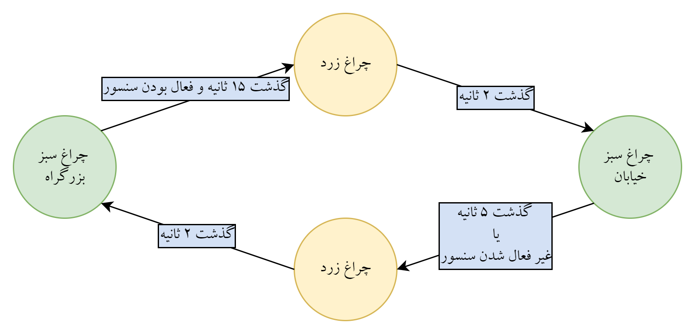

# FPGA Laboratory — Verilog Designs (Experiments 1–5)

FPGA laboratory course (آزمایشگاه FPGA) — B.Sc. Electrical Engineering, Isfahan University of Technology,
term 4012 (Fall 2022), student ID 9821663. Individual work, Xilinx ISE design flow (Verilog-2001).

**One-page overview (PDF): [`docs/project-overview.pdf`](docs/project-overview.pdf)** ·
**My submitted pre-reports (PDF, Persian): [`reports/`](reports)**

---

## The five experiments

| # | Experiment | Folder | What was built |
|---|---|---|---|
| 1 | Combinational building blocks | [`exp1-schematic/`](exp1-schematic) | Half adder, full adder, 2-bit multiplier, 4-bit ripple-carry adder and a 4-bit multiplier built from partial products (schematic entry vs Verilog) |
| 2 | PicoBlaze soft-core | [`exp2-picoblaze/`](exp2-picoblaze) | A **hex-to-7-segment decoder** driven from a PicoBlaze microcontroller output port |
| 3 | UART | [`exp3-uart/`](exp3-uart) | Serial link in two steps: a transmitter/receiver pair with a baud-rate clock divider (Q1), then a single `uart` module with shift/enable logic (Q2) |
| 4 | ChipScope in-system debug | [`exp4-chipscope/`](exp4-chipscope) | Embedding the Xilinx **ICON/ILA** cores to capture internal signals on the running device |
| 5 | Finite state machine | [`exp5-fsm/`](exp5-fsm) | A **traffic-light controller** as an FSM, with a BCD-to-7-segment display driver, a testbench and measured simulation results |

## Experiment 5 — traffic-light FSM (the most complete design)



Four states, implemented with a classic two-process FSM (next-state logic + registered state) plus an output-decoding
process, and parameterised with localparams (`HWG`, `Y1`, `SG`, `Y2`):

| From | To | Condition |
|---|---|---|
| Highway green | Highway yellow (`Y1`) | 15 s elapsed **and** the street sensor is active |
| Highway yellow | Street green (`SG`) | 2 s elapsed |
| Street green | Street yellow (`Y2`) | 5 s elapsed **or** the sensor becomes inactive |
| Street yellow | Highway green | 2 s elapsed |

```verilog
reg [1:0] state      = 2'b00;
reg [1:0] next_state = 2'b00;
localparam [1:0] HWG = ..., Y1 = ..., SG = ..., Y2 = ...;

always @(posedge clk) begin          // next-state logic
    case (state)
        HWG: if (<15 s elapsed> && sensor) next_state <= Y1;
        Y1:  if (<2 s elapsed>)            next_state <= SG;
        SG:  if (<5 s elapsed> || !sensor) next_state <= Y2;
        Y2:  if (<2 s elapsed>)            next_state <= HWG;
    endcase
end
always @(posedge clk) state <= next_state;
```

`Bcd_2_7seg.v` converts the digit to a 7-segment pattern (active-low output, `assign out = ~preOut;`) and the
`en_7seg_HW` / `en_7seg_S` enables select which counter is displayed.

## Experiment 4 — ChipScope

`exp4.v` wraps the design around the generated Xilinx debug cores (`icon_pro`, `ila_pro_0`, whose VHDL wrappers and
UCF files are kept in `chipscope-cores/`) so internal buses can be captured on hardware through the JTAG chain. The
`x1.coe` / `x2.coe` files are the small stimulus vectors used for the captured signals.

## Experiment 3 — UART

| File | Role |
|---|---|
| `exp3-q1/UART.v` | Top level of the transmitter/receiver pair |
| `exp3-q1/uart_transmitter.v` | Serialiser: the shift register is loaded as `{data_in, 1'b0}` — data with the start bit |
| `exp3-q1/uart_receiver.v` | Receiver sampling the incoming frame |
| `exp3-q1/clk_devider.v` | Baud-rate clock division from the board clock |
| `exp3-q2/uart.v`, `uart_t.v`, `shtstnen.v` | Second variant: single UART module with its own transmitter and shift/enable logic |

## Experiment 2 — PicoBlaze display driver

`hexT7seg.v` (module `hexTo7seg`) maps a 4-bit hex value to the seven segment lines with a `case` statement; the input
comes from the PicoBlaze processor's output port.

## Experiment 1 — combinational blocks

| Module | File |
|---|---|
| `Q1_halfAdder` | `Q1.v` |
| `Q1_fullAdder` | `Q1_fullAdder.v` |
| `Q2_2bitMultiplier` | `Q2_2bitMultiplier.v` |
| `Q3_4bitFulladder` | `Q3_4bitFulladder.v` |
| `Q3_4bitMultiplier` | `Q3_4bitMultiplier.v` — partial products (`mul2 << 2`, `mul3 << 2`, `mul4 << 4`) summed into an 8-bit result |

## Reports

| Report | File |
|---|---|
| Experiment 1 | [`reports/PreReport1_rabbani.pdf`](reports/PreReport1_rabbani.pdf) |
| Experiment 2 | [`reports/PreReport2_rabbani.pdf`](reports/PreReport2_rabbani.pdf) |
| Experiment 3 | [`reports/PreReport3_rabbani.pdf`](reports/PreReport3_rabbani.pdf) |
| Experiment 4 | [`reports/PreReport4_rabbani.pdf`](reports/PreReport4_rabbani.pdf) |
| Experiment 5 | the submitted archive holds the design and the measured results rather than a written report, so the results are included as [`exp5-fsm/Test_Result.pdf`](exp5-fsm/Test_Result.pdf) together with the state diagram |

## How to use the projects

The `.xise` project files are included for reference; the sources were reorganised into one folder per experiment, so
when opening a project in **Xilinx ISE** point it at the sources in the same folder (or create a fresh ISE project and
add them). Constraints (`.ucf`) and testbenches (`test.v`, `chipScope_test.v`) are included with each experiment.

> Course handouts, exam material, third-party archives and the vendor build trees (`_xmsgs`, `.ngd/.ncd`, ISim output)
> are deliberately not committed.

## Skills demonstrated

`Verilog RTL design (combinational, sequential, FSM)` · `hierarchical module design and instantiation` ·
`PicoBlaze soft-core integration` · `UART protocol implementation (baud generation, framing, shift registers)` ·
`FPGA in-system debug with ChipScope (ICON/ILA)` · `7-segment display drivers` · `testbenches and simulation-based
verification` · `Xilinx ISE flow (synthesis, UCF constraints, implementation, bitstream generation)`

## Context and licence

Laboratory work for the FPGA course at Isfahan University of Technology (term 4012, Fall 2022), carried out
individually. Published as a portfolio piece. Code released under the [MIT licence](LICENSE); the reports are
© Kiavash Rabbani Soudabi.
